# Arquitetura — Aember Arena

Guia visual de como as peças se encaixam. Gerado a partir do código real (commit `fa129a8`) com apoio do **graphify**.

- Grafo interativo: `graphify-out/graph.html` (abra no navegador; 2.206 nós, 4.321 arestas).
- Relatório: `graphify-out/GRAPH_REPORT.md`. Consultas: `graphify explain "applyMove"`, `graphify path "A" "B"`.
- Os diagramas C4 usam flowcharts com a notação `[Persona]/[Container]/[Component]` (compatível com qualquer renderer Mermaid).

---

## 1. Diagrama de blocos

### 1.1 Visão geral

O app React (`App.tsx`) é o orquestrador: chama o motor puro, lê/grava o catálogo e delega animação ao `FxLayer`. O motor nunca toca em I/O.

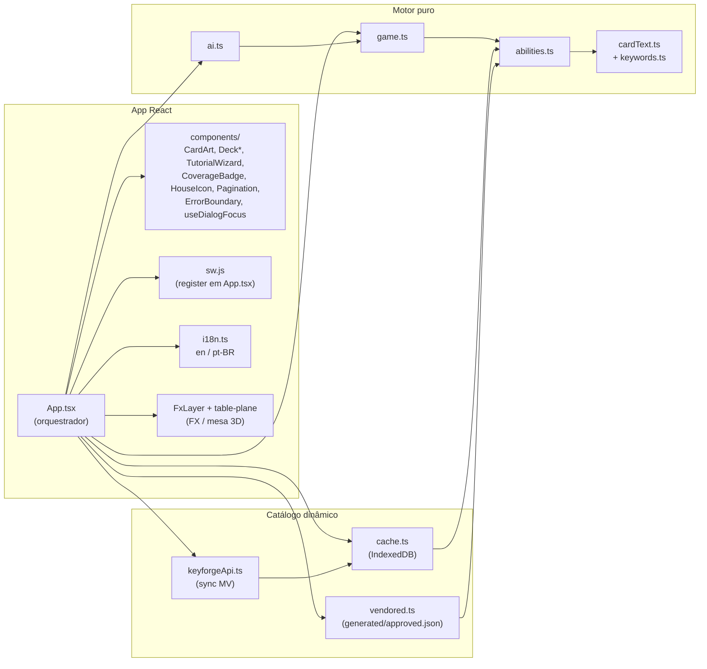

`abilities.ts` só importa tipos de `game.ts` (`import type`), então não há ciclo em runtime; `game.ts` importa `rulesOf` de `abilities.ts`. `vite.config` + `vite-plugin-singlefile` empacotam tudo em um `index.html`; `sw.js` é registrado por `App.tsx` (`./sw.js`, relativo) e faz cache LRU.

### 1.2 Catálogo, LLM, harvest, e2e e infra externa

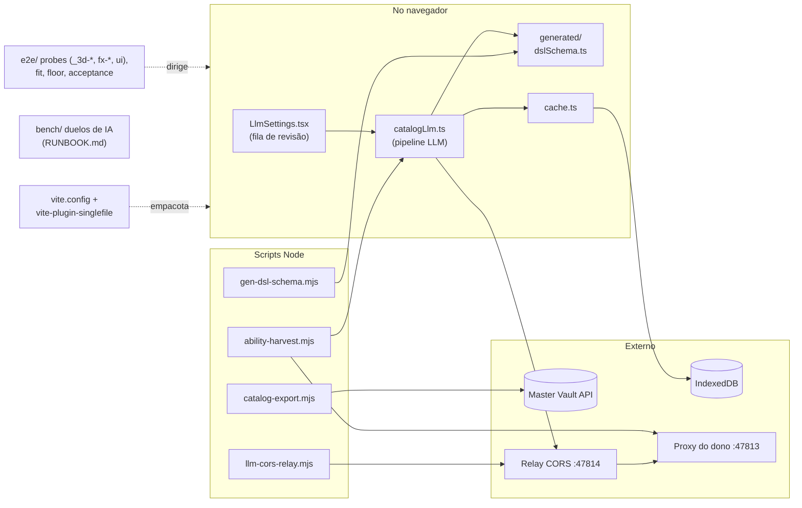

**Fluxo:** o navegador não fala direto com o proxy local (ele não responde preflight CORS), então passa pelo relay `:47814`, que repassa a `:47813`. O harvest roda em Node e reutiliza o mesmo `catalogLlm.ts` do app. O e2e (Playwright sobre Edge/Chrome) só dirige o app.

---

## 2. Diagramas de sequência

### 2a. Uma jogada do humano até o motor

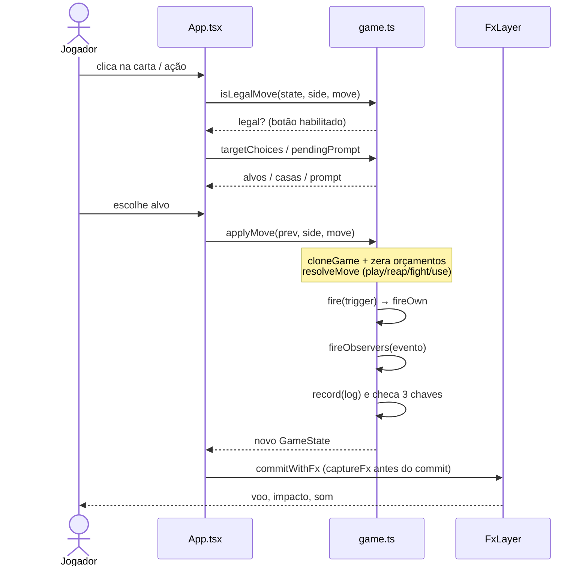

**Fluxo:** a UI só habilita o que `isLegalMove` aprova e coleta alvos pelos helpers do motor. `applyMove` clona o estado (nunca muta o original), resolve o movimento e dispara as habilidades. `commitWithFx` mede o DOM antes do commit para animar a transição.

### 2b. Pipeline de tradução (texto → DSL aprovada)

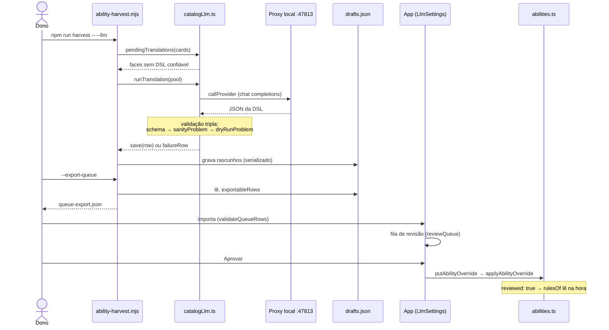

**Fluxo:** o harvest filtra o que falta, traduz em paralelo, valida cada rascunho 3 vezes e persiste em `drafts.json`. O export vira um arquivo importável; no app o dono revisa e aprova. Aprovar grava no IndexedDB e atualiza o mapa vivo do motor (sem recarregar).

### 2c. Importar deck do Master Vault e sincronizar catálogo

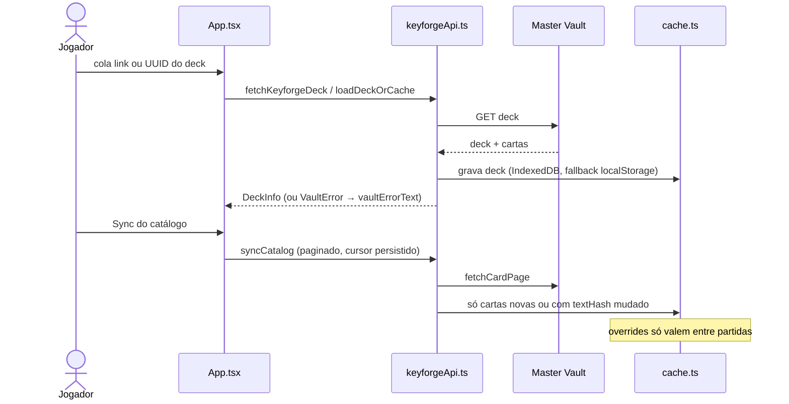

**Fluxo:** falha de rede cai no cache; o sync é incremental e cancelável.

### 2d. Desfazer (undo)

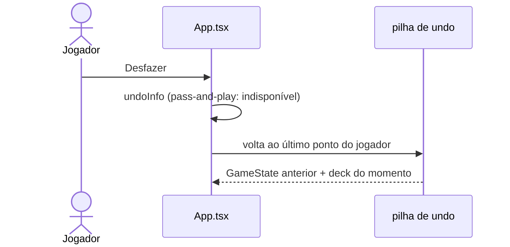

**Fluxo:** `commitGame` empilha cada transição (limite `UNDO_LIMIT` = 40); como o Sync pode trocar faces no meio do turno, cada entrada guarda também o deck.

---

## 3. C4

### C1 — Contexto

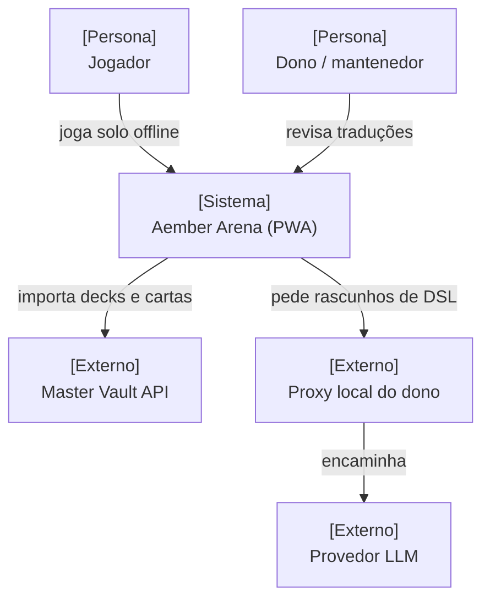

**Fluxo:** o jogador usa o PWA offline; a rede só entra para importar decks/cartas e, opcionalmente, traduzir texto de carta em DSL via LLM.

### C2 — Containers

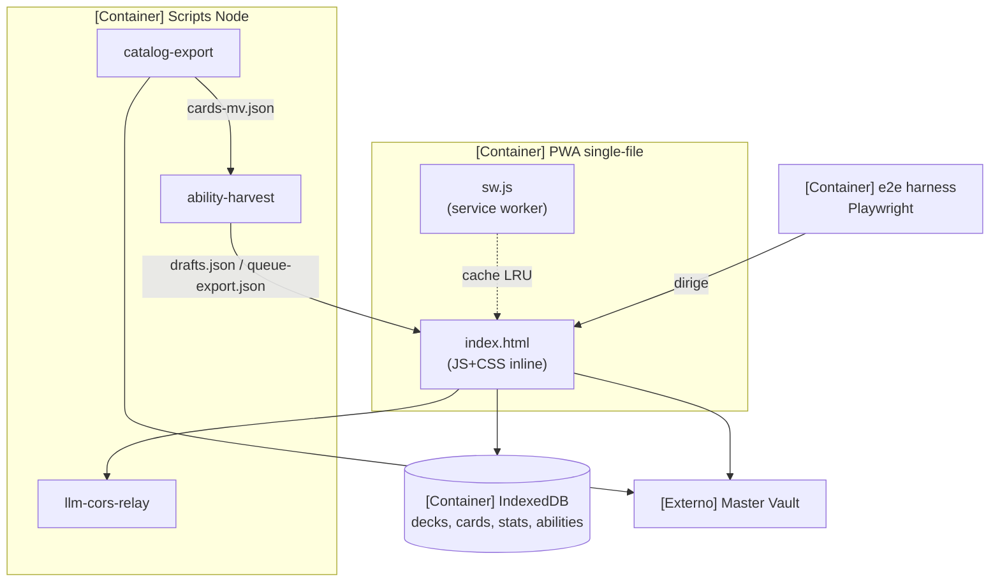

Probes (`e2e/probes/*`) e `bench/` (duelos de IA, `RUNBOOK.md`) ficam fora do bundle e só rodam em dev.

**Fluxo:** o bundle é autossuficiente (roda de `file://`). Estado persistente fica no IndexedDB (com fallback localStorage). Os scripts Node alimentam o app por arquivos, não por rede.

### C3 — Componentes (dentro do PWA)

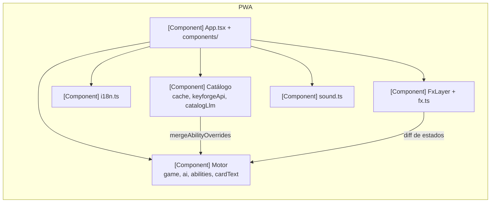

### C3 — Componentes (dentro dos scripts)

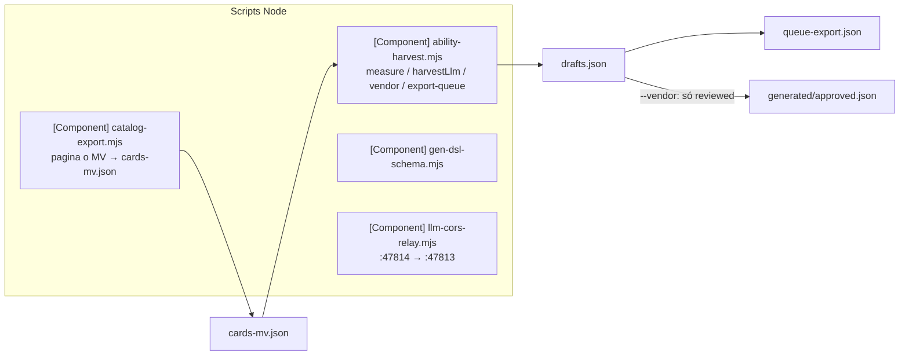

**Fluxo:** `catalog-export` baixa as cartas; `harvest` mede cobertura da gramática, gera rascunhos e exporta a fila. `--vendor` copia para `approved.json` só o que o dono aprovou.

### C4 — Código

#### rulesOf → regras efetivas de uma carta

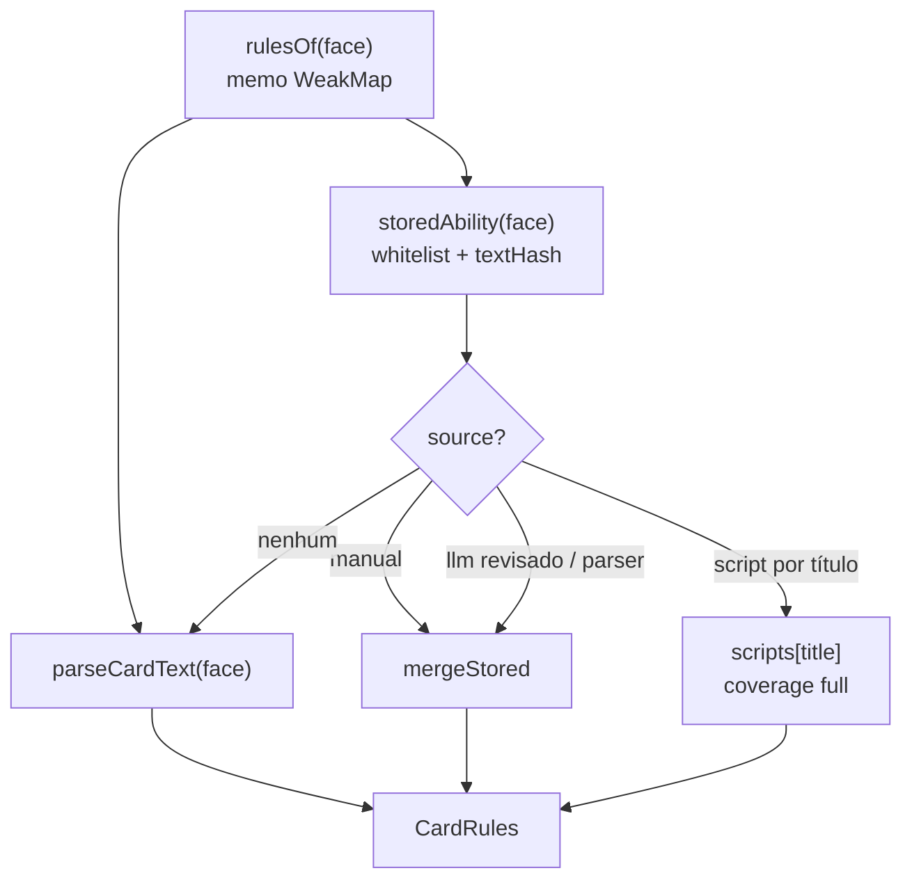

**Fluxo:** a ordem de precedência é: entrada `manual` → script escrito à mão → `llm` revisado ou `parser` congelado → parser ao vivo. Linhas com `textHash` diferente ou `llm` não revisado nunca chegam à mesa.

#### fire / fireObservers e orçamentos

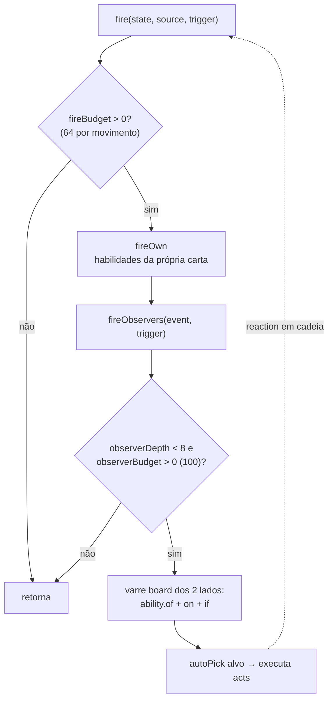

**Fluxo:** `applyMove` zera os orçamentos a cada movimento (`resetAbilityBudgets`). Os limites impedem laços de observadores e de "ready and use via reap".

#### runTranslation — pool e validação tripla

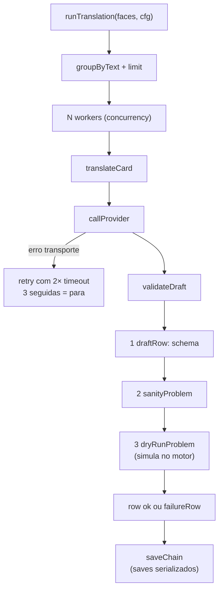

#### chooseAiMove — decisão da IA

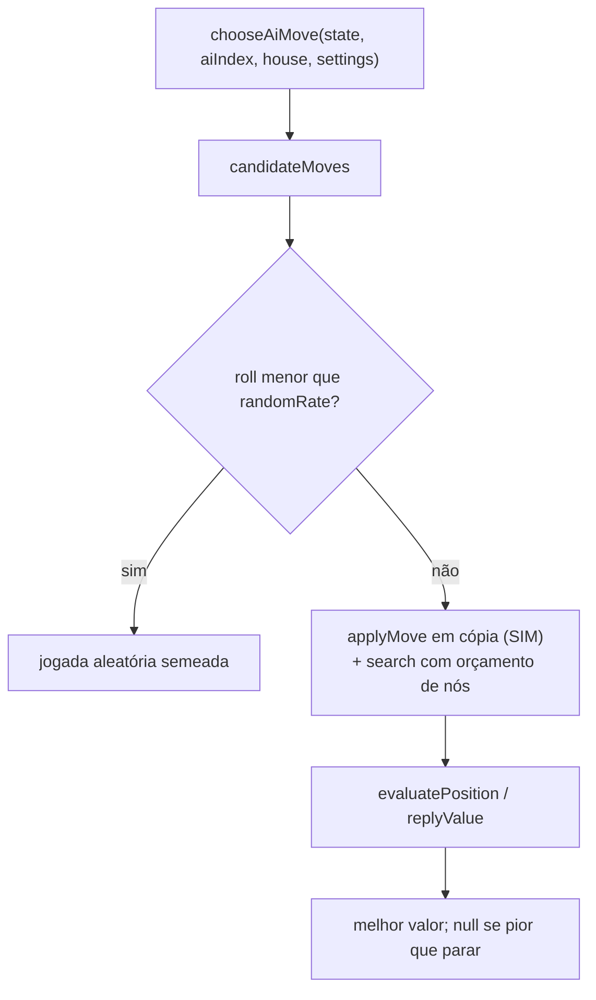

**Fluxo:** a IA usa só funções puras de `game.ts` (`applyMove`, `keyCost`, `houseOf`, efeitos persistentes), então vê as mesmas regras do jogador. O RNG vem da semente da partida.

#### Núcleo auxiliar: houseOf e keyCost

`houseOf(state, card)` resolve a casa efetiva (casa concedida, com guarda própria anti-laço) e `keyCost(state, side)` o custo da chave com efeitos persistentes (`forgeKey.less`, guarda anti-recursão). `isLegalMove`, `applyMove` e a IA os leem.

**Fluxo (runTranslation):** textos idênticos viram uma chamada só. Os workers buscam em paralelo, mas os `save` passam por uma cadeia de promessas (o `drafts.json` é reescrito inteiro). A cadeia é descarregada mesmo em abort, então nada já traduzido se perde.

---

## Notas do graphify

- **God nodes:** `App()` (97 arestas), `applyMove()` (51), `run()` (44), `textHash()` (33), `endTurn()` (31), `rulesOf()` (24).
- **Ciclos de import:** nenhum detectado.
- **Nós isolados:** 927 com ≤1 conexão (constantes e helpers de testes/probes, em sua maioria).
- Caminho `App → chooseAiMove → abilitiesOf → rulesOf` mostra que a IA consulta o mesmo motor de regras que o jogador.
- `harvestLlm()` chama `runTranslation()` direto: o Node reaproveita o pipeline do app.
